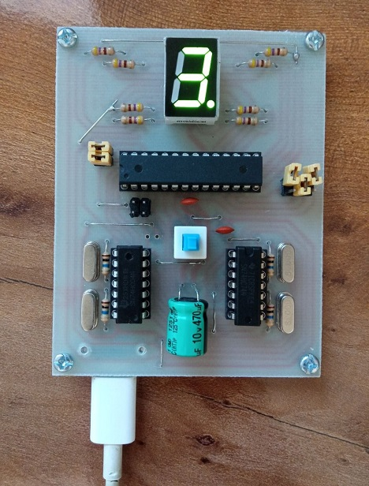

# Personal TRNG — Firmware (v1.19)

**AVR-BASCOM Firmware for the Personal True Random Number Generator (TRNG)**

## Overview

`personal_trng_firmware` is the embedded firmware for the **Personal TRNG** hardware platform (powered by the ATmega328 / ATmega328P microcontroller and written in AVR-BASCOM). It harvests physical hardware entropy from multi-crystal Pierce oscillator timing jitter and environmental shutter noise, conditioning the raw bitstreams through a multi-stage avalanche mixer (`NRNG`, `TRNG`, `MRNG`, and `HRNG` modes).

### Why Hardware TRNG Matters for Sensitive Keys & Crypto Wallets

Standard software random number generators (PRNGs) rely on deterministic algorithms and predictable system states. When generating high-stakes cryptographic material, any predictability or weak seed compromises security:

* **Cryptographic Keys & Passwords:** Strong encryption keys (AES, RSA, Ed25519, PGP) require genuine, non-deterministic entropy so private keys cannot be reconstructed or brute-forced.
* **Cryptocurrency Wallets & Seed Phrases:** Generating BIP-39 mnemonic seed phrases and private wallet keys on an air-gapped hardware TRNG eliminates reliance on potentially compromised operating systems, browser RNGs, or backdoored software libraries.
* **Auditable Physical Entropy:** By combining independent free-running 8 MHz crystal oscillators with hardware flip-flop jitter capture (`INT0`/`INT1`), this device produces true physical randomness you can inspect and verify directly.

---

## Hardware Prototype

<br>
*Personal TRNG hardware prototype running in the lab.*

## Hardware & Related Repositories

* **PCB Design & BOM:** [mixoftix/personal_trng_pcb](https://github.com/mixoftix/personal_trng_pcb) (Single-Sided & Double-Sided editions)
* **Target MCU:** ATmega328 / ATmega328P (`8 MHz` Internal RC Oscillator)
* **UART Interface:** `115200 baud` (8-N-1)

---

## License & Activation (\$5 USD)

This firmware is distributed under an **Audit-Only** license (see `LICENSE` for full terms). Source code inspection is permitted for security auditing; however, **commercial or operational deployment requires a valid license**.

To obtain a lifetime personal/operational license, send a one-time payment equivalent to **\$5 USD** to any of the official cryptocurrency addresses below:

* **BTC (Bitcoin):**
  ```text
  bc1pmha55eu9m9r90jge6tmfnaxrmv4agqqsf4xdkuhlnendk2yex2gs462sjx
  ```

* **SOL (Solana):**
  ```text
  25U8ZKsxDBBZnMeseeQHuUgoFvV8AqR7rdQ5x8kfJGjK
  ```

* **ETC (Ethereum Classic):**
  ```text
  0x0522619dcabef353e90f94eb6bf2a0eecd4fe90e
  ```

* **DOGE (Dogecoin):**
  ```text
  DBHJor249juRNCLQupy8BKyYSQicU6vpP4
  ```

### Proof of License
After completing your transaction, **save your Transaction Hash (TXID / Tx Hash)** in a safe place. Your confirmed on-chain transaction hash serves as your permanent, verifiable proof of a valid license.
